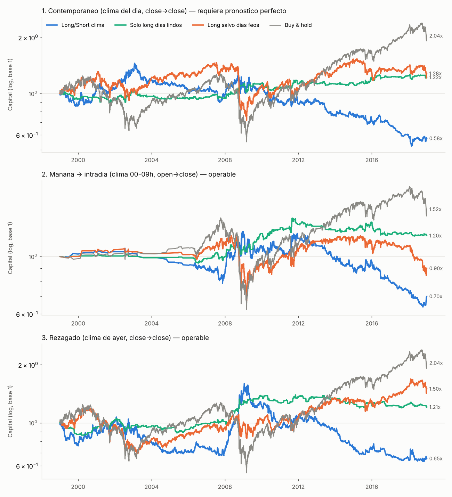
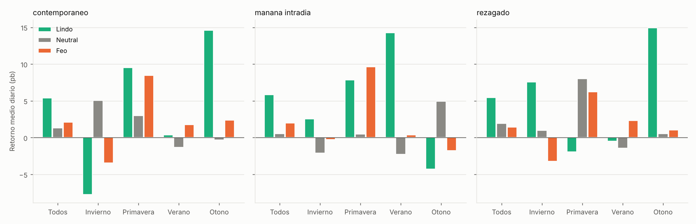
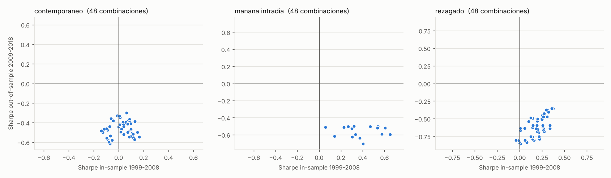

# Backtest: clima en Nueva York vs. S&P 500

**Pregunta:** ¿se gana yendo **long en días lindos** y **short en días feos** (lluvia, nieve, nublado cerrado, frío o calor extremo) en NY?

**Respuesta corta: no.** En 1999-2018 ninguna variante tiene ventaja estadística. La versión long/short pierde plata en las tres formas de timing. Los días lindos rinden un poco más en promedio (+3 a +4 pb/día frente a los feos), pero la diferencia es ruido (t ≈ 0,6-0,7; p de permutación 0,29-0,39). Además el efecto cambia de signo según la estación y el período.

```
python fetch_data.py   # descarga NOAA + S&P 500 -> data/
python backtest.py     # -> results/report.md, PNGs, CSVs
```

## Datos

| Qué | Fuente | Detalle |
|---|---|---|
| Tmax/Tmin, lluvia, nieve | NOAA GHCN-Daily, **Central Park** (USW00094728) | diario |
| Nubosidad, lluvia y nieve hora a hora, temperatura | NOAA ISD, **LaGuardia** (72503014732) | horario, agregado a "mañana" (00-09 h ET) y "día" (07-17 h ET) |
| S&P 500 OHLC | Yahoo `^GSPC` (incluido en el paquete `arch`) | 1999-01-04 → 2018-12-31, 5.030 días |

> Limitación: este entorno no tiene acceso a Yahoo, Stooq ni FRED. Por eso la única serie diaria de índice disponible fue el S&P 500 hasta 2018. Nasdaq y Dow no se probaron, pero tienen una correlación diaria >0,9 con el S&P. El código acepta cualquier CSV con columnas `date, Open, Close` en `data/spx_daily.csv` para extender el período o cambiar de índice.

## Qué es un día "lindo" o "feo" según la estación

La temperatura se mide como **anomalía respecto de la normal de ese día del año**. La normal sale de 1970-1998 (Tmax) y de 1990-1998 (temperatura matinal), es decir, solo de datos **anteriores** al backtest, así que no hay look-ahead. Un día de 5 °C es normal en enero y helado en abril.

| Estación | FEO si se cumple *cualquiera* | LINDO si no es feo y se cumple *todo* |
|---|---|---|
| Invierno (DJF) | lluvia ≥2,5 mm o ≥4 h, nieve, nubosidad ≥95 %, anomalía ≤ −5 °C, Tmax ≤ −2 °C | nubosidad ≤45 %, anomalía ≥ −2 °C |
| Primavera (MAM) | lluvia, nieve, nubosidad ≥95 %, anomalía ≤ −5 °C, Tmax ≥33 °C | nubosidad ≤45 %, anomalía entre −2 y +8 °C |
| Verano (JJA) | lluvia, nubosidad ≥90 %, **calor** Tmax ≥33 °C | nubosidad ≤40 %, anomalía entre −4 y +3 °C (no agobiante) |
| Otoño (SON) | lluvia, nieve, nubosidad ≥95 %, anomalía ≤ −5 °C, Tmax ≥33 °C | nubosidad ≤40 %, anomalía entre −2 y +8 °C |

El resto de los días quedan **neutrales** (flat). Con estos umbrales sale aproximadamente 13-19 % de días lindos, 38 % feos y el resto neutrales. Los parámetros están en `PARAMS` dentro de `backtest.py`.

## Tres formas de timing

1. **Contemporáneo**: el clima de todo el día *t* se aplica al retorno close(t−1)→close(t). Es el enfoque académico (Saunders 1993, Hirshleifer & Shumway 2003), pero **no se puede operar** salvo con un pronóstico perfecto.
2. **Mañana → intradía**: el clima observado entre las 00 y las 09 h ET decide la posición open→close del mismo día. **Se puede operar.** Solo usa días con un Open válido (en la serie de Yahoo el Open es igual al cierre anterior en la mayoría de los días de 1999-2006), por lo que cubre 3.027 días, sobre todo desde 2006.
3. **Rezagado**: el clima del día anterior se aplica al retorno close→close siguiente, con órdenes MOC. **Se puede operar.**

Todas las variantes incluyen un costo de 1 pb por lado.

## Resultados



| Variante | Long/Short clima | Solo long días lindos | Long salvo días feos | Buy & hold |
|---|---|---|---|---|
| 1. Contemporáneo | Sharpe **−0,13**, CAGR −2,7 % | 0,19 (12 % expuesto) | 0,16 | 0,28 |
| 2. Mañana → intradía | Sharpe **−0,15**, CAGR −2,9 % | 0,25 (19 % expuesto) | 0,01 | 0,28 |
| 3. Rezagado | Sharpe **−0,08**, CAGR −2,1 % | 0,18 (12 % expuesto) | 0,21 | 0,28 |

**Retorno medio diario por clase (todas las estaciones)**

| Variante | Lindo | Neutral | Feo | Lindo − Feo | t | p (permutación) |
|---|---|---|---|---|---|---|
| Contemporáneo | +5,4 pb | +1,3 | +2,1 | +3,3 pb | 0,62 | 0,39 |
| Mañana → intradía | +5,8 pb | +0,5 | +2,0 | +3,9 pb | 0,70 | 0,35 |
| Rezagado | +5,4 pb | +1,9 | +1,4 | +4,0 pb | 0,71 | 0,29 |



**Cómo leer estos números**

- **La dirección coincide con la hipótesis, pero el tamaño no es significativo.** Los días lindos rinden unos 4 pb más que los feos, mientras que el desvío diario del S&P es de unos 120 pb. Para que una diferencia así fuera significativa harían falta varias décadas más de datos.
- **No hay estabilidad por estación.** Con el clima del día completo, los días lindos de invierno rinden *menos* que los feos (−8 pb). En otoño la relación es fuerte, en verano no existe, y con la señal matinal el otoño se invierte. Ese patrón es el de ruido, no el de un efecto de "humor del trader".
- **El short destruye la estrategia.** En un mercado que sube, estar short el 38 % de los días cuesta caro. Por eso "Solo short días feos" tiene un Sharpe de −0,19 a −0,34. El componente long-only (0,18-0,25) se explica por estar comprado en un mercado alcista con poca exposición. No supera al buy & hold.
- **Regresión al estilo Hirshleifer-Shumway** (retorno contra nubosidad desestacionalizada): β = +4,1 pb al pasar de cielo despejado a cubierto, t = 0,66. Tiene el signo *contrario* al de la hipótesis y no es significativa. Coincide con la literatura, que encuentra que el efecto en NY desapareció después de los años 80-90 (el trading ya no se concentra físicamente en Manhattan).

**Robustez** (`results/grilla_parametros.csv`): se probaron 48 combinaciones de umbrales (nubosidad para "soleado" de 0,25 a 0,55, nubosidad para "cubierto" de 0,85 a 1,0, lluvia de 1 a 5 mm). Algunas tienen Sharpe positivo en 1999-2008, pero **0 de 48 son positivas en 2009-2018** en cualquiera de las variantes (mediana OOS entre −0,47 y −0,63). Optimizar los parámetros sobre el pasado solo ajusta ruido.



## Archivos

- `fetch_data.py`: descarga y agrega los datos de clima (GHCN e ISD) y los precios.
- `backtest.py`: clasificación, estrategias, permutaciones, grilla y gráficos.
- `data/`: datos diarios procesados (CSV).
- `results/report.md`: todas las tablas, incluidas las de estación por clase y los subperíodos.
- `results/senales_diarias.csv`: la señal y las variables de clima de cada día, para auditar.
- `results/grilla_parametros.csv`: el Sharpe IS/OOS de cada combinación de umbrales.
